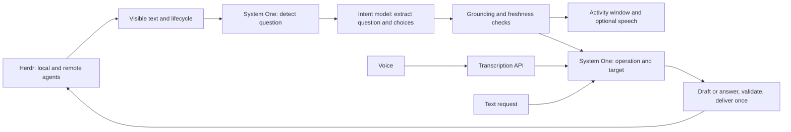

<p align="center">
  
</p>

<h1 align="center">Orchrd</h1>

<p align="center">
  <strong>Voice control for coding agents running in Herdr.</strong>
</p>

Hold a key, tell an agent what to do, and answer its questions by voice. Orchrd
brings agents from your local Herdr session and saved remote machines into one
GNOME panel and activity window.

Herdr supplies the live roster, terminal text, and input API. System One detects
questions and routes your requests; a separate model extracts question text and
choices. The same pipeline works across recognized agent types, including Codex
and NOBS, without agent-specific connectors or launch wrappers.

**Experimental:** question detection and terminal interaction still need testing
across more agent UIs. Automatic completion summaries are not implemented; ask
Orchrd to read an agent for a summary of its current visible output.

## What you can do

- Send work to a named agent, locally or on a saved remote machine.
- Hear an agent's current question and its numbered choices.
- Answer with a choice, multiple selections, or custom text when supported.
- Approve a request once, deny it, or explicitly select a persistent permission.
- Cancel agent work, request a readout, and repeat the last spoken response.
- Inspect routing, extraction, delivery, and speech in a native GTK activity window.
- Use your desktop microphone or an optional Apple TV remote.

Start coding agents normally inside Herdr. Orchrd discovers existing agents and
leaves their models, sessions, and terminal processes under their own control.

## Requirements

- Linux with a working desktop PipeWire session and Home Manager.
- GNOME Shell 50 or 51 for the panel extension and push-to-talk shortcut.
- Nix with flakes enabled.
- Herdr with at least one recognized coding agent running.
- A System One decision endpoint for routing, detection, and answer selection.
- An OpenAI-compatible chat-completions endpoint that accepts structured JSON
  output for extraction, request drafting, and requested summaries.
- An OpenAI-compatible transcription API, plus either a compatible speech API
  or local Pocket TTS assets.

Orchrd runs as a user service. NixOS is required only for the optional Apple TV
remote module, which handles system Bluetooth and uinput access.

## Setup

### 1. Add the Home Manager module

Add the input to your configuration flake:

```nix
inputs.orchrd = {
  url = "github:KacperLa/orchrd";
  inputs.nixpkgs.follows = "nixpkgs";
};
```

Import its module in your home configuration. This example uses API TTS, so the
local Pocket TTS worker is disabled:

```nix
{ config, orchrd, ... }:
{
  imports = [ orchrd.homeManagerModules.default ];

  services.orchrd = {
    enable = true;
    enablePocketTts = false;
    environmentFile = "${config.xdg.configHome}/orchrd/secrets.env";
  };
}
```

Pass `orchrd` through your existing Home Manager `extraSpecialArgs`. With Home
Manager inside NixOS, that is `home-manager.extraSpecialArgs = { inherit orchrd; };`.
Standalone Home Manager uses `extraSpecialArgs` on `homeManagerConfiguration`.
Keep your existing Home Manager installation and `home.stateVersion`.

The root flake exports `homeManagerModules.default` and
`packages.<system>.default`. The module installs the tools and GNOME extension,
creates `orchrd.service`, and optionally creates `orchrd-tts.service`.

| Home Manager option | Default | Purpose |
| --- | --- | --- |
| `services.orchrd.enable` | `false` | Install and run Orchrd |
| `services.orchrd.configFile` | `~/.config/orchrd/config.toml` | Runtime TOML path |
| `services.orchrd.environmentFile` | `null` | Provider credential environment file |
| `services.orchrd.enablePocketTts` | `true` | Run the local Pocket TTS worker |
| `services.orchrd.package` | Flake package | Override the installed package |

Install Herdr separately. It must be available on the user service's PATH, or
`agents.herdr_command` must name its absolute executable path.

### 2. Create the runtime configuration

Create `~/.config/orchrd/config.toml`. The following is a complete starting point
for API-based speech; replace the example URLs, models, and voice with those
provided by your services:

```toml
[agents]
herdr_command = "herdr"
herdr_session = "default"
discover_remote = true
screen_lines = 30
poll_seconds = 2

[routing]
endpoint = "https://decisions.example/v1/systemone"
model = "your-decision-model"
api_key = "" # Set the routing token here if required.
timeout_seconds = 30

[intent]
base_url = "https://models.example/v1"
model = "your-chat-model"
api_key_env = "ORCHRD_API_KEY"
timeout_seconds = 120

[stt.api]
base_url = "https://speech.example/v1"
model = "your-transcription-model"
api_key_env = "ORCHRD_STT_API_KEY"
timeout_seconds = 60

[tts]
provider = "openai_compatible"

[tts.api]
base_url = "https://speech.example/v1"
model = "your-speech-model"
voice = "your-voice"
api_key_env = "ORCHRD_TTS_API_KEY"
timeout_seconds = 120

[voice]
announcement_mode = "muted"
```

`routing.endpoint` is the **complete System One URL**, rather than a generic
chat-completions URL. The other `base_url` fields are API roots, including `/v1`
when required. These services can run locally or remotely.

Speech API compatibility means multipart WAV transcription with a JSON `text`
response, and TTS that accepts `response_format = "pcm"` and streams **24 kHz,
mono, signed 16-bit little-endian PCM**. A compatible chat endpoint alone does
not provide these audio capabilities.

For local Pocket TTS instead, use the [example configuration](config.example.toml)
and the [Pocket TTS setup](#local-pocket-tts) below.

### 3. Provide credentials

Create the file referenced by `environmentFile`, outside the Nix store:

```text
ORCHRD_API_KEY=your-model-key
ORCHRD_STT_API_KEY=your-transcription-key
ORCHRD_TTS_API_KEY=your-speech-key
```

```bash
chmod 600 ~/.config/orchrd/config.toml ~/.config/orchrd/secrets.env
```

Use the environment-variable names configured in each `api_key_env` field. Set
`api_key_env = ""` for an unauthenticated service. The routing token is configured
separately through `routing.api_key` in the private runtime TOML.

Keep runtime configuration and credentials outside Nix expressions and generated
store files. Orchrd sends audio, terminal text, and speech text to the configured
APIs for their respective tasks.

### 4. Rebuild and start using it

With Home Manager integrated into NixOS:

```bash
sudo nixos-rebuild switch --flake /path/to/your/config#your-host
```

With standalone Home Manager:

```bash
home-manager switch --flake /path/to/your/config#your-user
```

Enable **Orchrd** in GNOME Extensions, start agents in Herdr, and check:

```bash
systemctl --user status orchrd.service
orchrdctl status
```

Hold <kbd>Print Screen</kbd> while speaking and release it to transcribe and
route the request. To test without a microphone:

```bash
orchrdctl dispatch "Ask the reviewer to inspect the failing tests"
```

Restart `orchrd.service` after changing its runtime configuration or credentials.
To fetch a newer pinned Orchrd revision, run `nix flake update orchrd` in your
configuration flake before rebuilding. An ordinary rebuild uses the current lock.

## Local and remote agents

`agents.herdr_session` selects the local Herdr session. With
`discover_remote = true`, Orchrd also discovers every enabled saved machine from
`herdr machine list`, using each machine's saved session.

Configure remote access in Herdr first. It must work noninteractively from the
Orchrd user service. You can inspect discovery directly:

```bash
herdr --session default agent list
herdr machine list --json
herdr machine status --json
herdr --machine <saved-machine-id> agent list
```

Local display names use the project directory. Agents sharing a project use
available terminal titles to distinguish their tasks. Remote names also include
the saved machine label. Window and pane IDs remain internal; agent and instance
identities are qualified by machine to prevent collisions.

An unavailable machine does not remove healthy machines' agents. Disabling or
removing a saved machine withdraws its agents on the next poll; changing its
saved destination or session invalidates earlier captures and questions.
Screen reads and input always go back to the machine that owns the agent.

Set `discover_remote = false` for local-only monitoring.

## Using questions and voice controls

Open **Orchrd Activity** from the application launcher, choose **Open activity**
in the panel, or run `orchrd-activity`. Its **Agent questions** panel shows the
current extracted questions and available controls.

Typical requests:

```text
Ask the reviewer to check the build.
Read the reviewer.
Choose option two.
Use the first and third options.
Approve the request.
Deny it.
Cancel the reviewer.
```

Name an agent when the target would otherwise be ambiguous. An unspecified reply
can target the sole applicable pending question; ordinary requests can use the
last-interacted agent or a sole available agent. Ambiguous names require
clarification. Each utterance executes at most one operation.

**Approve** selects an unambiguous **allow once** option. Persistent permission
requires explicitly selecting that option. Menu choices need visible shortcuts
or supported navigation controls; checkbox menus also need visible checked
states. Custom answers are available only when the question supports them.
If controls cannot be established, Orchrd can present the question but leaves
answering to the terminal. Such questions appear with `read_only: true`.

The panel also provides automatic speech, interaction sounds, and **Repeat last
response**. Muted questions remain visible without being queued for later speech.
Starting push-to-talk interrupts current playback and clears queued speech.
Question readouts preserve the offered choices; requested summaries are brief.

| Command | Action |
| --- | --- |
| `orchrdctl status` | Show agents, activity, and `observed_questions` |
| `orchrdctl dispatch "…"` | Route a text request through the voice controller |
| `orchrdctl mode auto` | Speak newly presented questions automatically |
| `orchrdctl mode muted` | Keep automatic presentation silent |
| `orchrdctl rescan` | Retry unchanged screens that did not yield a question |
| `orchrdctl repeat-last` | Replay the last completed spoken response |
| `orchrdctl start` / `stop` | Begin recording / stop and transcribe |
| `orchrdctl cancel` | Cancel microphone recording |

To change the push-to-talk shortcut:

```bash
gsettings set org.gnome.shell.extensions.orchrd push-to-talk "['Print']"
```

## How it works



One Rust coordinator owns application state and exposes it over the session
D-Bus. Herdr supplies live agent state. Roster discovery runs across machines;
visible screens are read for idle, done, or blocked agents. Changed screens must
settle before two background workers detect and extract current questions.
Unchanged screens are attempted once unless explicitly rescanned.

| Configuration | Role |
| --- | --- |
| `[routing]` | System One operation/target selection, dialog detection, and answer interpretation |
| `[intent]` | Structured question extraction, work-request drafting, and requested summaries |
| `[stt.api]` | Transcription after microphone release |
| `[tts]` | Local Pocket TTS or streaming API speech |

Routing receives the current utterance, live agents, and pending questions.
Request drafting receives the current utterance and selected recipient. Previous
replies and delivery receipts are not replayed as routing memory.

Questions bind to a machine, agent instance, lifecycle sequence, terminal
capture, and question ID. Orchrd checks them again before input, consumes
question IDs once, and does not automatically retry uncertain deliveries.
Prompts use Herdr's agent prompt API; menus and forms use its key-input API.
Receipts distinguish accepted input from an observed response or completed work.

Microphone audio is captured through PipeWire into memory and uploaded after
release; transcription is not live-streaming. Recordings are limited to two
minutes and discarded after transcription or cancellation. One speech worker
plays utterances in order, with streaming playback for API TTS.

### Current limits

- Extraction remains experimental. Literal grounding and completeness checks
  cannot prove semantic correctness or that every option was captured.
- Tested extraction calls have taken roughly 20–60 seconds, with one taking about
  65 seconds. Two workers handle all agents, so simultaneous questions can wait.
- There is no fixed agent-count cap. Sequential screen reads and model throughput
  determine practical capacity; the default poll delay is two seconds after a scan.
- The default capture is the bottom 30 visible lines. `screen_lines` accepts
  10–200; questions outside the capture or truncated menus may need manual input.
- Screen checks, saved-machine checks, and Herdr input are not atomic. Concurrent
  terminal or machine-configuration changes can still race the final check.
- Read requests summarize current captured terminal text. Automatic completion
  summaries and full transcript recovery are not implemented.

The [historical pipeline evaluations](experiments/dialog_detector/PIPELINE.md)
and [extractor experiment](experiments/question_extractor/README.md) document
measured cases and failures. They do not establish reliability across all UIs.

## Local Pocket TTS

Pocket TTS is the default when `tts.provider` is omitted. To use it, keep
`services.orchrd.enablePocketTts = true` and configure:

```toml
[tts]
provider = "pocket"
language = "english_2026-04"
model_config = "/home/you/.local/share/orchrd/pocket-tts/english_2026-04.yaml"
voice = "/home/you/.local/share/orchrd/pocket-tts/voice.safetensors"
quantize = true
```

Keep the YAML, referenced model weights and tokenizer assets, and voice files
in user data outside the Nix store. Use absolute configuration paths. `voice`
accepts a compatible reference WAV or exported `.safetensors` voice state.
The package includes the Pocket TTS program; model and voice assets are supplied
separately. Disabling its worker does not remove Pocket TTS from the package.

## Optional Apple TV remote

The remote has its own NixOS flake under [`apple_tv_remote/`](apple_tv_remote/).
It provides a Bluetooth touchpad through uinput and an Opus microphone through
PipeWire. Holding Siri selects the remote microphone and starts recording;
release drains the audio, submits it to Orchrd, and restores the previous input
unless you changed sources while recording.

Dragging the touchpad's right edge scrolls vertically, dragging its top edge
scrolls horizontally, and a mechanical click in the top-right corner is a right
click. The shared zone definitions live in
[`apple_remote_zones.py`](apple_tv_remote/apple_remote_zones.py).

Add this separate input to your NixOS flake:

```nix
inputs.apple-tv-remote = {
  url = "github:KacperLa/orchrd?dir=apple_tv_remote";
  inputs.nixpkgs.follows = "nixpkgs";
};
```

In a host module with `apple-tv-remote` in scope:

```nix
{
  imports = [ apple-tv-remote.nixosModules.default ];
  users.users.you.uid = 1000; # Use your existing user's numeric UID.

  services.apple-tv-remote = {
    enable = true;
    user = "you";
    macAddress = "AA:BB:CC:DD:EE:FF";
    edgeMm = 2; # Scroll strip width; raise it if edge scrolling feels unreachable.
    cornerMm = 4; # Top-right right-click zone; must be at least edgeMm.
  };
}
```

Pair the remote first. The module configures Bluetooth/uinput permissions and
creates the system services `apple-remote-mouse.service` and
`apple-remote-mic.service`. It needs the selected user's PipeWire session and
`orchrdctl` from the Home Manager setup. Rebuild NixOS to apply it.

The scroll strips are narrow on purpose: they are measured inward from the pad's
measured extreme, which a finger only reaches when it is rolled against the
remote's own side. Contacts further in move the pointer. Once a contact starts in
a strip it keeps scrolling for the whole touch, so a swipe does not fall back to
pointer movement when the finger drifts inward.

## Diagnostics

Start with the roster and service log:

```bash
orchrdctl status
journalctl --user -u orchrd.service -f
```

`orchrdctl doctor` checks configuration, credential availability, and local TTS
files without contacting providers or requiring D-Bus. It uses your **shell's**
environment, so export the configured credentials before running it. The daemon
performs the same checks using its service environment at startup.

| Symptom | Check |
| --- | --- |
| An agent is missing | Compare the configured local session and enabled machines with Herdr's own rosters |
| A remote is missing | Run `herdr machine status --json` and its machine-specific `agent list`; check service SSH access |
| A question is missing | Inspect detection/extraction activity, allow for model latency, then try `orchrdctl rescan` |
| A question is read-only | Its controls could not be grounded; answer in the terminal |
| Microphone returns no audio | Check the active PipeWire input, or the Apple remote microphone service |
| Configuration fails after upgrading | Remove obsolete options listed below and run `doctor` with the service credentials |

The activity window shows extraction, routing, delivery, and speech events, with
inspectable arguments and outcomes. Its recent activity resets on daemon restart;
conversation history, settings, and receipts persist in SQLite.

| Data | Default location |
| --- | --- |
| Runtime configuration | `~/.config/orchrd/config.toml` |
| Conversation history and receipts | `~/.local/share/orchrd/orchrd.sqlite3` |
| TTS socket and temporary runtime data | `$XDG_RUNTIME_DIR/orchrd/` |

These locations follow the corresponding XDG directory settings. For local TTS,
inspect `journalctl --user -u orchrd-tts.service -f`. Apple remote logs use system
`journalctl -u apple-remote-mic.service` and `apple-remote-mouse.service`.

### Upgrading from connector-based versions

Remove `[agents].backend` from runtime TOML and `enableCodex`,
`startCodexServer`, `codexCommand`, and `codexSocket` from `services.orchrd` in
Home Manager. The Codex adapter, launcher, shared server, and NOBS socket listener
have been removed. Start agents normally in Herdr.

Older voice configurations must also remove `[stt].provider`,
`[voice].voxtype_state_file`, and `[voice].transcription_timeout_seconds`; configure
`[stt.api]` instead. Existing conversation history is preserved. Old structured
response queues are archival and are never replayed.

## Development

```bash
./scripts/test.sh
```

This enters the pinned Nix shell and runs formatting, Rust tests, Clippy, GNOME
extension tests, Apple TV remote tests, TTS tests, and headless GTK tests. The default tests use local
fixtures and need no API credentials or running agent. Live tests are explicitly
ignored by default.

Build and check the working tree, including uncommitted files:

```bash
nix build path:.
nix flake check path:.
```

Use `nix develop path:.` for an interactive shell. Cargo build/check/test/clippy
commands refresh the [static call graph](docs/call-graph/README.md), unless
`ORCHRD_SKIP_CALLGRAPH=1` is set. Regenerate it explicitly with
`python3 scripts/regenerate_call_graph.py` from that shell.

The core paths are [Herdr discovery/input](src/herdr.rs),
[dialog detection/extraction](src/dialog.rs),
[terminal input plans](src/terminal_input.rs), and the
[controller](src/controller.rs). The GNOME extension lives in [`extension/`](extension/),
the GTK window in [`ui/`](ui/), and local speech support in [`tts/`](tts/).

The application icon is adapted from Lucide's
[trees-forest](https://github.com/lucide-icons/lucide/blob/main/lab/trees-forest.svg)
icon, copyright Lucide Icons and contributors, under the
[ISC License](extension/icons/LICENSE).
