<p align="center">
  
</p>

<h1 align="center">Orchrd</h1>

<p align="center">
  <strong>A voice-first control surface for persistent coding agents.</strong>
</p>

<p align="center">
  Connect NOBS sessions, hold a key, and move work forward by voice.
</p>

Orchrd turns GNOME into a lightweight voice interface for software work. It
uses configurable speech providers (Voxtype and Pocket TTS by default),
classifies your request with a System One decision model, and
routes work across all connected NOBS sessions. When a coding agent needs input, Orchrd asks
you. When the work finishes, it can speak a short summary or stay silent and
show a notification.

Orchrd is deliberately small. It is not another coding agent and it does not
replace your terminal workflow. It is the layer that keeps several projects
moving while your hands and attention are elsewhere. NOBS owns sessions
and agents; Orchrd has no separate project registry.

## How it works

```mermaid
flowchart LR
    Voice[You speak] --> Shell[GNOME extension]
    Shell --> STT[STT provider]
    STT --> Router[Orchrd controller]
    Router --> Decision[Kev: operation and target]
    Decision --> Draft[LLM: request text only]
    Draft --> Execute[Controller: execute once]
    Execute --> Frontend[Connected NOBS sessions]
    Frontend --> Agent[Coding agents]
    Agent --> Summary[Response summary]
    Summary --> TTS[TTS provider]
    TTS --> Voice
```



1. Hold <kbd>Print Screen</kbd> while speaking.
2. Orchrd records and transcribes the utterance using the selected STT provider.
3. Kev chooses the operation and named target. The controller resolves target
   fallbacks from the live roster and last-interacted agent.
4. Orchrd sends a cleaned, non-speculative request to the appropriate connected agent.
5. If an agent asks a question, Orchrd reads its numbered choices and sends your
   reply to that pending question. Permission requests use separate approve/deny
   controls. Delivery acknowledgements are based on the frontend's receipt and
   observed state changes.
6. When an agent responds, Orchrd summarizes the structured final message from
   NOBS, including turns started directly in the NOBS TUI.
7. Depending on the selected mode, the selected TTS provider speaks the result immediately or
   Orchrd stays muted and plays a notification sound.

After selecting an agent for a send operation, a separate LLM call writes only
its `request` text from the current utterance and selected recipient. It has no
conversation transcript or routing tools. The controller supplies the agent ID,
validates the draft, and sends it once; drafting does not confirm delivery.

Kev classifies the current utterance into an operation and a named target in
one System One request. It receives the utterance, connected agent names, and live pending questions,
with `unspecified` and `unknown` target choices. The controller resolves an
unspecified target to the sole connected agent or the last-interacted connected
agent. Missing or duplicate names require clarification. Confidence scores are
recorded for inspection; no unvalidated confidence threshold is applied.

The `[routing]` configuration selects the System One endpoint, model, optional
Bearer API key, and timeout. These settings apply to routing and question choices.
The `[intent]` LLM drafts requests and summarizes agent output; it no longer
selects tools or generates delivery acknowledgements. Routing failure stops the
turn, without falling back to an unconstrained LLM. Each utterance executes at
most one operation; multi-agent instructions should be issued separately.
Previous Orchard replies, summaries, and receipts are never replayed as routing
memory. History remains in SQLite for inspection. Legacy `[conversation]`
settings remain accepted for compatibility but no longer control a tool loop.

Sending work, reading agent output, approving or denying a prompt, and
cancelling work are separate tool operations. NOBS creates and owns its sessions;
Orchrd interacts only with agents already present. Tool results distinguish message
delivery from an observed agent response: delivery alone does not prove that work
started or an approval succeeded. Unconfirmed operations are never automatically
resent. Spoken output is also normalized
in code to plain text of at most two sentences, without Markdown or numbered
lists.

### Runtime architecture

One coordinator owns application state. NOBS is the source of
live agent status; Orchrd does not maintain a second set of coding-task states.

- Each interactive NOBS process connects through a private local socket,
  registers as one agent in the shared roster, and sends authoritative state,
  final responses, and structured permission requests. Orchrd sends prompts,
  cancellation, and exact permission selections back over that connection; it
  never scrapes terminal output.
- A summary worker processes those responses, appends each summary to the
  shared conversation history once, and queues speech when auto-speak is on.
  One speech worker plays responses in order. Slow model calls or audio playback
  do not block status observation.
- User turns are processed serially. Connected agents may appear or disappear
  between turns; the model receives a refreshed roster before each call.
- Mutating tools register a pending operation before sending to an agent. Their
  promises resolve from delivery receipts and observed status changes, or expire
  with an explicit unconfirmed outcome. Sending to an already-working agent
  confirms delivery only, not that the new request has begun.

Pending summaries survive service restarts, but old audio is not replayed.
Interrupted deliveries are recorded as unconfirmed and are not retried. NOBS
sends final output and permission requests directly; Orchrd polls its local
bridge only for the latest roster and status snapshot.

## Components

| Component | Responsibility |
| --- | --- |
| `orchrdd` | Rust controller, deterministic dispatch, state reconciliation, approvals, and D-Bus API |
| GNOME extension | Panel menu, push-to-talk shortcuts, status, and notifications |
| `orchrd-activity` | Native GTK4 activity window rendering coordinator snapshots over D-Bus |
| `orchrd-tts` | Persistent local Pocket TTS worker with ordered playback |
| Voxtype | Recording and speech-to-text |
| NOBS | Interactive coding-agent TUI; a patched local process registers itself with Orchrd |
| Kev | System One classification of operation and named target |
| Request/summary LLM | Drafts request text and summarizes agent output |
| Coding models | Coding, repository inspection, and implementation inside NOBS |

The patched NOBS build is required; Voxtype is needed only for local STT. Orchrd
does not install or configure the coding models used by NOBS.

## Requirements

- Nix with flakes enabled
- NixOS with Home Manager
- GNOME Shell 50 or 51 (including 51 prereleases)
- A working `voxtype` command and user service (local STT), or a compatible STT API
- A patched NOBS build with native Orchrd bridge support
- At least one interactive NOBS session
- A reachable System One endpoint configured in `[routing]`
- An OpenAI-compatible chat-completions endpoint with tool-calling support and
  an API key
- Pocket TTS assets stored locally, or a compatible TTS API

## Setup

### 1. Add Orchrd to your NixOS flake

Add the repository as an input:

```nix
inputs.orchrd.url = "github:KacperLa/orchrd";
```

Make the Home Manager module available and enable Orchrd for your user:

```nix
{
  home-manager.sharedModules = [ orchrd.homeManagerModules.default ];

  home-manager.users.you = {
    services.orchrd = {
      enable = true;
      configFile = "/home/you/.config/orchrd/config.toml";
    };
  };
}
```

After rebuilding, enable Orchrd using the GNOME Extensions application.

The module installs Orchrd into the user profile and creates two user services:

- `orchrd.service` owns the conversation loop, agent bridge, speech integration,
  persistent state, and D-Bus API used by the extension.
- `orchrd-tts.service` keeps Pocket TTS loaded and serializes audio playback.

NOBS sessions register with Orchrd while both programs run. Orchrd does not
start or stop NOBS, and no session selection is needed.

### 2. Create the configuration file

Copy [config.example.toml](config.example.toml) to
`~/.config/orchrd/config.toml` and edit it manually:

```bash
mkdir -p ~/.config/orchrd
cp /path/to/orchrd/config.example.toml ~/.config/orchrd/config.toml
```

At minimum, configure the conversational endpoint, model, and local TTS assets:

```toml
[intent]
base_url = "https://api.openai.com/v1"
model = "gpt-5-mini"
api_key_env = "ORCHRD_API_KEY"

[routing]
endpoint = "http://192.168.1.104:8009/v1/systemone"
model = "kev-latest"
api_key = "" # Set the decision API's Bearer token here if required.
timeout_seconds = 30

[voice]
announcement_mode = "muted"

[tts]
language = "english_2026-04"
model_config = "/home/you/.local/share/orchrd/pocket-tts/english_2026-04.yaml"
voice = "/home/you/.local/share/orchrd/pocket-tts/voice.safetensors"
quantize = true
```

No project paths or discovery roots are required. Start the patched interactive
NOBS binary normally; Orchrd discovers every running instance automatically.

`routing.endpoint` is the complete decision API URL, including `/v1/systemone`;
`routing.url` is an alias. An omitted or empty `routing.api_key` sends no
Authorization header. Restart `orchrd.service` after changing these settings.

When updating an older configuration, rename `[voice].max_recording_seconds`
to `transcription_timeout_seconds`, and remove `[summary].cloud_context` and
`include_diff`. These obsolete keys are now rejected to avoid silently ignoring
settings. The transcription timeout starts after recording stops; it does not
limit how long you can hold push-to-talk. Existing SQLite conversation history
is preserved. Former run and agent-binding tables are no longer used; live
agents are discovered directly from their bridge connections.

### 3. Provide the API key

The variable named by `intent.api_key_env` must be available to the systemd
user manager, not only to an interactive shell. A convenient local option is
an environment file such as `~/.config/environment.d/90-orchrd.conf`:

```text
ORCHRD_API_KEY=your-key-here
```

Log out and back in after creating it, or import the variable into the current
user manager before restarting Orchrd. Do not place secrets directly in a Nix
module because Nix store contents are world-readable.

### Optional: use remote or self-hosted speech providers

STT and TTS are independent: keep either local, or select `openai_compatible`.
Existing configurations default to Voxtype and Pocket TTS. There is no automatic
fallback between local and remote services.

For example, replace the corresponding sections of your config with:

```toml
[stt]
provider = "openai_compatible"

[stt.api]
base_url = "https://api.openai.com/v1"
model = "gpt-4o-mini-transcribe"
api_key_env = "ORCHRD_STT_API_KEY"
timeout_seconds = 60

[tts]
provider = "openai_compatible"

[tts.api]
base_url = "https://api.openai.com/v1"
model = "gpt-4o-mini-tts"
voice = "coral"
api_key_env = "ORCHRD_TTS_API_KEY"
timeout_seconds = 120
```

These adapters use the [audio transcription API](https://developers.openai.com/api/reference/resources/audio/subresources/transcriptions/methods/create)
and [speech API](https://developers.openai.com/api/docs/guides/text-to-speech).
Other providers must implement those contracts; a compatible chat endpoint alone
is not enough. STT requires multipart WAV upload and a JSON `text` response. TTS
requires streaming raw **24 kHz, mono, signed 16-bit little-endian PCM**. Set each
`base_url` to the API root (including `/v1` if required), not the audio endpoint.
For an unauthenticated local server, omit `api_key_env`. Use HTTPS for remote
servers. Models and voice names depend on the provider.

Push-to-talk and its shortcut are unchanged. With remote STT, Orchrd captures the
default PipeWire microphone into memory, stops on key release, then uploads a WAV.
Recordings are limited to two minutes and discarded after transcription or
cancellation; no recording file is stored. STT is **not live-streaming**. Remote
TTS plays incoming audio chunks without buffering the whole utterance, and PTT
interrupts playback. Errors surface normally; requests are not silently retried
against another provider.

Remote STT sends your microphone audio to that provider; remote TTS sends the
spoken response text. These services may incur charges and have their own data
retention policies. Generated speech is synthetic, not a human recording.

For provider TTS, disable the unused local worker in Home Manager:

```nix
services.orchrd = {
  enable = true;
  enablePocketTts = false; # Keep true when tts.provider = "pocket".
  environmentFile = "${config.home.homeDirectory}/.config/orchrd/secrets.env";
};
```

Create that file outside the Nix store, restrict it to your user (`chmod 600`),
and set the variables named in your config, e.g. `ORCHRD_STT_API_KEY=...` and
`ORCHRD_TTS_API_KEY=...` (plus your intent API key if needed). Rebuild your Home
Manager configuration and restart `orchrd.service`. PipeWire tools are provided
by the flake; no imperative installation is needed. Skip the next asset step
when not using Pocket TTS. The package still includes Pocket TTS, even when its
worker is disabled.

### 4. Prepare Pocket TTS assets (local TTS only)

Create a user-data directory and place the Pocket TTS assets there:

```text
~/.local/share/orchrd/pocket-tts/
├── english_2026-04.yaml
├── model weights referenced by the YAML
├── tokenizer assets referenced by the YAML
└── voice.safetensors
```

The model YAML must reference the corresponding local files. The `tts.voice`
setting accepts a compatible reference WAV or exported `.safetensors` voice
state. Orchrd packages the Pocket TTS program, but keeps large model and voice
assets outside the Nix store as user data.

### 5. Build and activate

Update Orchrd's lock entry to fetch the latest revision, then rebuild:

```bash
cd /path/to/your/nixos-config
nix flake update orchrd
sudo nixos-rebuild switch --flake .#your-host
```

Reload the extension after an extension-only change:

```bash
orchrd_uuid="$(gnome-extensions list | grep '^orchrd@' | head -n1)"
gnome-extensions disable "$orchrd_uuid"
gnome-extensions enable "$orchrd_uuid"
```

### 6. Verify the services

```bash
systemctl --user status orchrd.service
systemctl --user status orchrd-tts.service
orchrdctl status
```

## Using Orchrd

The default push-to-talk key is <kbd>Print Screen</kbd>. Hold it while speaking
and release it to transcribe and route the request.

Each patched NOBS instance registers its live session. Orchrd monitors all connected
sessions and shows them in the panel without a picker.

Orchrd also watches responses from turns you start directly in NOBS,
not just requests sent by voice. NOBS sends final responses and
permission requests as structured events. Orchrd records a short summary
and speaks it if **Auto speak results** is enabled. It does not read terminal
scrollback.

The panel shows the controller state and each connected agent on its
own row. It also provides:

- **Open activity** to inspect live agent lanes and the voice/routing pipeline
- **Auto speak results** to switch between immediate speech and muted notifications
- **Interaction sounds** to enable or disable push-to-talk progress cues
- **Repeat last response** to hear the last thing Orchrd spoke again

With interaction sounds enabled, stopping recording plays a short confirmation
tone. Finishing transcription plays a brighter ping followed by a two-pulse
routing cue. These are one-shot sounds rather than loops, so a slow model call
does not produce continuous audio.

Muted completions are recorded normally but are not placed in a pending-results
queue. Ask Orchrd for an agent status when you want to catch up.
**Repeat last response** replays the most recent utterance that finished speaking,
and remains available after a service restart. If multiple spoken responses
arrive together, Orchrd plays them in order without interrupting either one.
Starting push-to-talk is the explicit interruption: it stops current speech and
clears any audio still waiting to play.

### Codex sessions

`orchrd-codex` connects to a shared local Codex app server over a Unix WebSocket
and registers its loaded top-level threads with Orchard. It supports prompts,
steering an observed active turn, cancellation, completion announcements,
command/file approvals, and ordinary user questions. Multiple questions are
answered one at a time; the combined answer goes back to the original Codex
request. An answer made in the Codex terminal clears the pending voice question.

The terminal and adapter must use **the same app server**. This does not attach
to an arbitrary independent Codex process. Existing history is not read aloud
when attaching. Loaded idle sessions remain available; archived/closed sessions
are removed when Codex unloads them. Spawned subagents are excluded.
New empty sessions become available after Codex has saved their first history.

For Home Manager:

```nix
services.orchrd = {
  enableCodex = true;
  startCodexServer = true;
  # codexCommand = "/absolute/path/to/codex"; # defaults to codex on PATH
};
```

After rebuilding, start the services and open a terminal client on their socket:

```bash
systemctl --user start orchrd-codex-server.service orchrd-codex.service
orchrd codex
```

`orchrd codex` supplies the shared-server address and forwards additional Codex
arguments unchanged, for example `orchrd codex resume`. It keeps the current
directory and terminal. The server must already be running. Home Manager sets
the launcher socket and executable to match the bridge configuration; load the
updated session environment after rebuilding. Without Home Manager, the default
is `$XDG_RUNTIME_DIR/orchrd-codex/server.sock`; override it with
`ORCHRD_CODEX_SOCKET=/path/to/socket` and optionally `ORCHRD_CODEX_COMMAND`.

If you already run a shared Codex daemon, leave `startCodexServer = false` and
set `codexSocket` to its control socket if it differs from
`~/.codex/app-server-control/app-server-control.sock`.

Without Home Manager, run each long-lived process in a separate terminal:

```bash
# Server (skip if your shared Codex daemon is already running):
codex app-server --listen unix://
# Orchard adapter:
orchrd-codex
# Interactive client:
codex --remote unix://
```

Use `orchrd-codex --codex-socket /path/to/socket` for a custom server socket.
The adapter reconnects after either service restarts and never retries a prompt
whose delivery is uncertain. It preserves Codex's model, credentials, and
permission configuration. Secret questions and unsupported permission types
(including scoped filesystem/network grants and MCP forms) stay in the Codex
terminal. Voice approval grants only the current command or file-change request.
If the adapter joins mid-turn without its turn ID, it waits for the next observed
turn before offering steering/cancellation.

Protocol reference: [Codex app server](https://learn.chatgpt.com/docs/app-server).
The installed Codex must support Unix WebSockets and the shared-thread APIs;
these interfaces are experimental. The adapter uses Python with `websockets`,
included in the Nix package.

Test the adapter with `python3 -m unittest discover -s adapters`. An optional
real-server smoke test uses a temporary Codex home and local fixture history,
and sends no inference:

```bash
nix develop --command bash -c 'ORCHRD_CODEX_SMOKE=1 "$ORCHRD_BRIDGE_PYTHON" -m unittest discover -s adapters -v'
```

### NOBS sessions

The patched local NOBS checkout connects to Orchrd automatically from ordinary
interactive mode. Each process receives a unique `nobs:<pid>:<random>` identifier
in Orchrd's roster. Text entered in NOBS and requests sent by voice reach the
**same session and transcript**. NOBS reports exact lifecycle state, final assistant
text, and structured permission requests; voice approvals select its real
`allow_once` or `reject_once` option. For multiple-choice questions, Orchrd reads
all numbered options without summary truncation. Reply with an option number,
label, multiple selections when offered, or your own answer when allowed.
Kev first classifies your reply as an option selection, custom answer, or
clarification. For selections, a second Kev call decides which offered options
your utterance includes. These calls receive only the current reply and question
data; custom answers preserve your utterance verbatim. Both bridges validate
the option IDs and question ID before accepting an answer; a stale answer cannot resolve a newer question. Ordinary questions never use
the yes/no permission controls. The normal NOBS TUI remains fully usable.

After rebuilding NOBS and Orchrd, restart `orchrd.service` and start NOBS normally.
Do not launch `nobs --acp`; ACP mode is a separate frontend and does not run the TUI.

Example requests:

```text
Ask the reviewer to inspect the failing tests.
What did the agent just finish?
Approve the request.
Ask it why that test is failing.
```

To change the shortcuts:

```bash
gsettings set org.gnome.shell.extensions.orchrd push-to-talk "['Print']"
```

## Native activity window

Launch **Orchrd Activity** from GNOME, select **Open activity** in the panel,
or run `orchrd-activity`. It uses GTK4 and Cairo through PyGObject—no browser,
web server, or separate model interpreting logs.

The graph has an Orchrd lane and a lane per agent. Endpoints render the actual
NOBS status: blue/spinning for working, gray for idle, green/pulsing for done,
and amber for blocked. Status-transition nodes retain what NOBS reported;
delivery acceptance never changes an agent's endpoint.

Coordinator-owned nodes expose utterance/transcription, model waiting, exact tool
arguments, delivery and confirmation, summary persistence, and
queued/playing/skipped speech. Curves connect explicit parent operation IDs;
they do not guess which user request caused independently observed agent output.
Action-specific vector glyphs sit inside the nodes; status and elapsed time are
centered underneath. Hover for the full action name. Stream names stay in a sticky footer.
Click a node (or use the inspector dropdown and arrow keys) to see its data,
timestamps, and transitions. **Follow** keeps the latest activity visible.

The window consumes the same versioned snapshot as the panel and resynchronizes
when the daemon reconnects. Activity is recent, in-memory diagnostic state for
the live agent roster, not a new persistent history store: daemon restarts clear
it. At most 200 records are retained unless more operations
are still pending. Large detail payloads are explicitly marked as truncated.
The underlying conversation history and captured-response queue remain in SQLite.

This displays tool decisions and their observable results, not hidden model
reasoning. NOBS sends responses directly; the current agent roster and status
are sampled from the local bridge.

## Command-line controls

`orchrdctl` exposes the same D-Bus controller used by the extension:

```bash
orchrdctl status
orchrdctl dispatch "what is Orchrd working on?"
orchrdctl mode auto
orchrdctl mode muted
orchrdctl repeat-last
orchrdctl start
orchrdctl stop
orchrdctl cancel
```

## Diagnostics

Follow controller logs, including failed conversational tool calls:

```bash
journalctl --user -u orchrd.service -f
```

Every conversational tool call is logged as selected and then as succeeded or
failed. Completion summarization is a separate model call. If that call returns
invalid output, the coding task remains complete and Orchrd records a short
fallback message rather than treating the task itself as failed.

Inspect the other runtime services:

```bash
journalctl --user -u orchrd-tts.service -f
```

Runtime data lives in standard XDG locations:

- Conversation history, captured responses, delivery receipts, and settings:
  `$XDG_DATA_HOME/orchrd/orchrd.sqlite3`
- Temporary transcripts and the TTS socket: `$XDG_RUNTIME_DIR/orchrd/`
- User configuration: `$XDG_CONFIG_HOME/orchrd/config.toml`

## Development

From a fresh terminal, run all tests and code checks with:

```bash
./scripts/test.sh
```

The script enters the pinned Nix development shell automatically and runs Rust
formatting checks, tests, Clippy, GNOME extension tests, TTS worker tests, and
headless GTK viewer tests. It stops at the first failure without reformatting
files or restarting services. No API keys or running Orchrd instance are needed.
You can also invoke it by its absolute path from another directory. The first
run may download Nix dependencies; it does not install them into your profile.

For an interactive development shell, use `nix develop`.

Build the complete package, including the extension and TTS worker:

```bash
nix build
nix flake check
```

Orchrd is currently an early, personal project. Its configuration and D-Bus
surface may change while the interaction model settles.

The application icon is adapted from Lucide's
[trees-forest](https://github.com/lucide-icons/lucide/blob/main/lab/trees-forest.svg)
icon, copyright Lucide Icons and contributors, and used under the ISC License.
