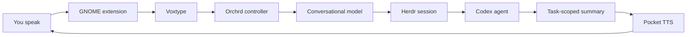

<p align="center">
  
</p>

<h1 align="center">Orchrd</h1>

<p align="center">
  <strong>A voice-first control surface for persistent coding agents.</strong>
</p>

<p align="center">
  Hold a key, say what you want, and let Orchrd route the request to the right Codex session in Herdr.
</p>

Orchrd turns GNOME into a lightweight voice interface for software work. It
listens through Voxtype, interprets your request with a small conversational
agent, and operates persistent Codex sessions managed by Herdr. When a coding
agent needs input, Orchrd asks you. When the work finishes, it can speak a
short summary or save it until you are ready to listen.

Orchrd is deliberately small. It is not another coding agent and it does not
replace your terminal workflow. It is the layer that keeps several projects
moving while your hands and attention are elsewhere.

## How it works



1. Hold <kbd>Print Screen</kbd> or press and hold **Hold to talk** in the panel.
2. Orchrd asks Voxtype to record and transcribe the utterance.
3. The conversational model interprets the request, resolves explicit
   references from recent dialogue, and chooses an Orchrd tool.
4. Orchrd sends a cleaned, non-speculative request to the appropriate Codex
   agent in Herdr.
5. If Codex requests approval or clarification, Orchrd announces it and lets
   you respond naturally.
6. When the task finishes, Orchrd summarizes only that task's terminal output.
7. Depending on the selected mode, Pocket TTS speaks the result immediately or
   Orchrd plays a notification sound and queues it for later.

The conversation has a rolling window, so replies such as “approve it,” “ask
it why,” or “continue with that project” can refer to the immediately preceding
exchange. Conversation history is retained in SQLite; only the latest configured
number of messages is sent to the conversational model, and no compaction is
currently performed.

## Components

| Component | Responsibility |
| --- | --- |
| `orchrdd` | Rust controller, conversation tool loop, state reconciliation, approvals, and D-Bus API |
| `orchrd@kacper.local` | GNOME Shell panel menu, push-to-talk shortcuts, status, and notifications |
| `orchrd-tts` | Persistent local Pocket TTS worker |
| Voxtype | Recording and speech-to-text |
| Herdr | Persistent terminal workspaces and coding-agent sessions |
| Codex | Coding, repository inspection, and implementation |

Voxtype, Herdr, and Codex are system prerequisites. Orchrd's flake does not
install or replace them.

## Requirements

- Nix with flakes enabled
- NixOS with Home Manager
- GNOME Shell 50
- A working `voxtype` command and user service
- A working `herdr` command
- A working system `codex` command
- An OpenAI-compatible chat-completions endpoint and API key
- Pocket TTS model, tokenizer, and voice assets stored locally

## Setup

### 1. Add Orchrd to your NixOS flake

Add the repository as an input:

```nix
inputs.orchrd.url = "path:/home/you/Documents/Projects/orchrd";
```

Make the Home Manager module available and enable Orchrd for your user:

```nix
{
  home-manager.sharedModules = [ orchrd.homeManagerModules.default ];

  home-manager.users.you = {
    services.orchrd = {
      enable = true;
      configFile = "/home/you/.config/orchrd/config.toml";
    };

    dconf.settings."org/gnome/shell".enabled-extensions = [
      "orchrd@kacper.local"
    ];
  };
}
```

If you already manage `enabled-extensions`, add Orchrd to that existing list
instead of defining the setting twice.

The module installs Orchrd into the user profile and creates three user
services: `orchrd.service`, `orchrd-tts.service`, and, by default,
`orchrd-herdr.service`. To use an independently managed Herdr server:

```nix
services.orchrd.enableHerdrServer = false;
```

### 2. Create the configuration file

Copy [config.example.toml](config.example.toml) to
`~/.config/orchrd/config.toml` and edit it manually:

```bash
mkdir -p ~/.config/orchrd
cp /path/to/orchrd/config.example.toml ~/.config/orchrd/config.toml
```

At minimum, configure the conversational endpoint, model, local TTS assets,
and project discovery root:

```toml
[intent]
base_url = "https://api.openai.com/v1"
model = "gpt-5-mini"
api_key_env = "ORCHRD_API_KEY"

[discovery]
roots = ["/home/you/Documents/Projects"]

[tts]
language = "english_2026-04"
model_config = "/home/you/.local/share/orchrd/pocket-tts/english_2026-04.yaml"
voice = "/home/you/.local/share/orchrd/pocket-tts/voice.safetensors"
quantize = true
```

Each immediate child directory under a discovery root becomes a project.
Discovery is not recursive. Explicit `[[projects]]` entries can provide a
stable ID, display name, or override for a discovered directory:

```toml
[[projects]]
id = "orchrd"
name = "Orchrd"
path = "/home/you/Documents/Projects/orchrd"
goal = "Build the voice-driven coding-agent controller"
```

Project paths and discovery roots must exist when Orchrd starts. Project IDs
may contain lowercase letters, digits, hyphens, and underscores.

### 3. Provide the API key

The variable named by `intent.api_key_env` must be available to the systemd
user manager, not only to an interactive shell. A convenient local option is
an environment file such as `~/.config/environment.d/90-orchrd.conf`:

```text
ORCHRD_API_KEY=your-key-here
```

Log out and back in after creating it, or import the variable into the current
user manager before restarting Orchrd. Do not place secrets directly in a Nix
module because Nix store contents are world-readable.

### 4. Prepare Pocket TTS assets

Create a user-data directory and place the Pocket TTS assets there:

```text
~/.local/share/orchrd/pocket-tts/
├── english_2026-04.yaml
├── model weights referenced by the YAML
├── tokenizer assets referenced by the YAML
└── voice.safetensors
```

The model YAML must reference the corresponding local files. The `tts.voice`
setting accepts a compatible reference WAV or exported `.safetensors` voice
state. Orchrd packages the Pocket TTS program, but keeps large model and voice
assets outside the Nix store as user data.

### 5. Build and activate

For a local path input, refresh only Orchrd's lock entry before rebuilding:

```bash
cd /path/to/your/nixos-config
nix flake update orchrd
sudo nixos-rebuild switch --flake .#your-host
```

Reload the extension after an extension-only change:

```bash
gnome-extensions disable orchrd@kacper.local
gnome-extensions enable orchrd@kacper.local
```

### 6. Verify the services

```bash
systemctl --user status orchrd.service
systemctl --user status orchrd-tts.service
systemctl --user status orchrd-herdr.service
orchrdctl status
```

## Using Orchrd

The default push-to-talk key is <kbd>Print Screen</kbd>. Hold it while speaking
and release it to transcribe and route the request. You can also hold the
**Hold to talk** row in the panel menu.

The panel shows the controller state and each project session on its own row.
It also provides:

- **Open Herdr** to open the Orchrd Herdr session in GNOME Console
- **Auto speak results** to switch between immediate speech and queued results
- **Speak next result** to read the oldest queued completion
- **Dismiss next result** to discard the oldest queued completion

Example requests:

```text
Ask the Orchrd agent to fix the failing tests.
Start a new session for Bike FSD.
Resume the latest Orchrd session.
What did the agent just finish?
Approve the request.
Ask it why that test is failing.
```

To change the shortcuts:

```bash
gsettings set org.gnome.shell.extensions.orchrd push-to-talk "['Print']"
gsettings set org.gnome.shell.extensions.orchrd speak-next "['<Ctrl><Alt><Shift>space']"
```

## Command-line controls

`orchrdctl` exposes the same D-Bus controller used by the extension:

```bash
orchrdctl status
orchrdctl dispatch "what is Orchrd working on?"
orchrdctl mode auto
orchrdctl mode queued
orchrdctl speak-next
orchrdctl dismiss-next
orchrdctl start
orchrdctl stop
orchrdctl cancel
```

## Diagnostics

Follow controller logs, including failed conversational tool calls:

```bash
journalctl --user -u orchrd.service -f
```

Inspect the other runtime services:

```bash
journalctl --user -u orchrd-tts.service -f
journalctl --user -u orchrd-herdr.service -f
```

Runtime data lives in standard XDG locations:

- Conversation, project, run, and result state:
  `$XDG_DATA_HOME/orchrd/orchrd.sqlite3`
- Temporary transcripts and the TTS socket: `$XDG_RUNTIME_DIR/orchrd/`
- User configuration: `$XDG_CONFIG_HOME/orchrd/config.toml`

## Development

Enter the development shell and run the test suite:

```bash
nix develop
cargo test
```

Build the complete package, including the extension and TTS worker:

```bash
nix build
nix flake check
```

Orchrd is currently an early, personal project. Its configuration and D-Bus
surface may change while the interaction model settles.
