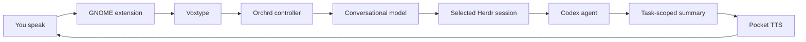

<p align="center">
  
</p>

<h1 align="center">Orchrd</h1>

<p align="center">
  <strong>A voice-first control surface for persistent coding agents.</strong>
</p>

<p align="center">
  Pick a Herdr session, hold a key, and route your request to the right Codex agent by voice.
</p>

Orchrd turns GNOME into a lightweight voice interface for software work. It
uses Voxtype for recording and transcription, interprets your request with a
small tool-calling conversational agent, and operates Codex agents inside one
Herdr session selected by you. When a coding agent needs input, Orchrd asks
you. When the work finishes, it can speak a short summary or stay silent and
show a notification.

Orchrd is deliberately small. It is not another coding agent and it does not
replace your terminal workflow. It is the layer that keeps several projects
moving while your hands and attention are elsewhere.

## How it works



1. Hold <kbd>Print Screen</kbd> while speaking.
2. Orchrd asks Voxtype to record and transcribe the utterance.
3. The conversational model interprets the request, resolves explicit
   references from recent dialogue, and chooses an Orchrd tool.
4. Orchrd sends a cleaned, non-speculative request to the appropriate Codex
   agent in the Herdr session you selected from the panel.
5. If Codex requests approval or clarification, Orchrd announces it. A natural
   reply such as “approve it” is converted into an explicit approval tool call,
   sent to Herdr, and reported as successful only after the agent leaves its
   blocked state.
6. When the task finishes, Orchrd summarizes only that task's terminal output.
7. Depending on the selected mode, Pocket TTS speaks the result immediately or
   Orchrd stays muted and plays a notification sound.

The conversation has a rolling window, so replies such as “approve it,” “ask
it why,” or “continue with that project” can refer to the immediately preceding
exchange, including what Orchrd just said. Conversation history is retained in
SQLite; only the latest configured number of messages is sent to the
conversational model, and no compaction or long-term memory is currently
performed.

The model receives a minimal routing snapshot containing project names, project
IDs, agent states, and the active project. Project paths, project goals, Herdr
pane details, and internal context markers are excluded. Requests sent to Codex
are cleaned semantic transcriptions: Orchrd may fix obvious recognition errors
and remove filler, but it is instructed not to invent requirements, rationale,
implementation details, or acceptance criteria.

Starting an empty Codex session, resuming its latest saved conversation,
sending work, reading agent output, approving or denying a prompt, and
cancelling work are separate tool operations. Orchrd acknowledges state-changing
operations only after the operation succeeds. Spoken output is also normalized
in code to plain text of at most two sentences, without Markdown or numbered
lists.

## Components

| Component | Responsibility |
| --- | --- |
| `orchrdd` | Rust controller, conversation tool loop, state reconciliation, approvals, and D-Bus API |
| GNOME extension | Panel menu, push-to-talk shortcuts, status, and notifications |
| `orchrd-tts` | Persistent local Pocket TTS worker with ordered playback |
| Voxtype | Recording and speech-to-text |
| Herdr | User-owned persistent terminal workspaces and coding-agent sessions |
| Codex | Coding, repository inspection, and implementation |

Voxtype, Herdr, and Codex are system prerequisites. Orchrd's flake does not
install or replace them.

## Requirements

- Nix with flakes enabled
- NixOS with Home Manager
- GNOME Shell 50
- A working `voxtype` command and user service
- A working `herdr` command
- A working system `codex` command
- An OpenAI-compatible chat-completions endpoint with tool-calling support and
  an API key
- Pocket TTS model, tokenizer, and voice assets stored locally

## Setup

### 1. Add Orchrd to your NixOS flake

Add the repository as an input:

```nix
inputs.orchrd.url = "github:KacperLa/orchrd";
```

Make the Home Manager module available and enable Orchrd for your user:

```nix
{
  home-manager.sharedModules = [ orchrd.homeManagerModules.default ];

  home-manager.users.you = {
    services.orchrd = {
      enable = true;
      configFile = "/home/you/.config/orchrd/config.toml";
    };
  };
}
```

After rebuilding, enable Orchrd using the GNOME Extensions application.

The module installs Orchrd into the user profile and creates two user services:

- `orchrd.service` owns the conversation loop, Voxtype integration, Herdr
  monitoring, persistent state, and D-Bus API used by the extension.
- `orchrd-tts.service` keeps Pocket TTS loaded and serializes audio playback.

Orchrd discovers running Herdr sessions but does not start, stop, or monitor
unselected sessions.

If you prefer an always-running dedicated fallback session, enable the optional
Herdr service and give it a name:

```nix
services.orchrd = {
  enableHerdrServer = true;
  herdrSession = "orchrd";
};
```

Select that fallback from the GNOME panel after it starts. Picker choices are
remembered in Orchrd's local database.

### 2. Create the configuration file

Copy [config.example.toml](config.example.toml) to
`~/.config/orchrd/config.toml` and edit it manually:

```bash
mkdir -p ~/.config/orchrd
cp /path/to/orchrd/config.example.toml ~/.config/orchrd/config.toml
```

At minimum, configure the conversational endpoint, model, local TTS assets,
and project discovery root:

```toml
[intent]
base_url = "https://api.openai.com/v1"
model = "gpt-5-mini"
api_key_env = "ORCHRD_API_KEY"

[discovery]
roots = ["/home/you/Documents/Projects"]

[voice]
announcement_mode = "muted"

[tts]
language = "english_2026-04"
model_config = "/home/you/.local/share/orchrd/pocket-tts/english_2026-04.yaml"
voice = "/home/you/.local/share/orchrd/pocket-tts/voice.safetensors"
quantize = true
```

Each immediate child directory under a discovery root becomes a project.
Discovery is not recursive. Explicit `[[projects]]` entries can provide a
stable ID, display name, or override for a discovered directory:

```toml
[[projects]]
id = "orchrd"
name = "Orchrd"
path = "/home/you/Documents/Projects/orchrd"
goal = "Build the voice-driven coding-agent controller"
```

Project paths and discovery roots must exist when Orchrd starts. Project IDs
may contain lowercase letters, digits, hyphens, and underscores.

### 3. Provide the API key

The variable named by `intent.api_key_env` must be available to the systemd
user manager, not only to an interactive shell. A convenient local option is
an environment file such as `~/.config/environment.d/90-orchrd.conf`:

```text
ORCHRD_API_KEY=your-key-here
```

Log out and back in after creating it, or import the variable into the current
user manager before restarting Orchrd. Do not place secrets directly in a Nix
module because Nix store contents are world-readable.

### 4. Prepare Pocket TTS assets

Create a user-data directory and place the Pocket TTS assets there:

```text
~/.local/share/orchrd/pocket-tts/
├── english_2026-04.yaml
├── model weights referenced by the YAML
├── tokenizer assets referenced by the YAML
└── voice.safetensors
```

The model YAML must reference the corresponding local files. The `tts.voice`
setting accepts a compatible reference WAV or exported `.safetensors` voice
state. Orchrd packages the Pocket TTS program, but keeps large model and voice
assets outside the Nix store as user data.

### 5. Build and activate

Update Orchrd's lock entry to fetch the latest revision, then rebuild:

```bash
cd /path/to/your/nixos-config
nix flake update orchrd
sudo nixos-rebuild switch --flake .#your-host
```

Reload the extension after an extension-only change:

```bash
orchrd_uuid="$(gnome-extensions list | grep '^orchrd@' | head -n1)"
gnome-extensions disable "$orchrd_uuid"
gnome-extensions enable "$orchrd_uuid"
```

### 6. Verify the services

```bash
systemctl --user status orchrd.service
systemctl --user status orchrd-tts.service
orchrdctl status
```

If you enabled the optional dedicated server, also check
`systemctl --user status orchrd-herdr.service`.

## Using Orchrd

The default push-to-talk key is <kbd>Print Screen</kbd>. Hold it while speaking
and release it to transcribe and route the request.

The panel has a picker containing currently running Herdr sessions. Orchrd
connects to and monitors only the selected session; changing the selection does
not stop, modify, or inspect the others. Existing Codex panes in the selected
session are associated with discovered projects using their working directory,
so no Herdr window needs to be committed to a project repository.

The panel shows the controller state and each associated project agent on its
own row. It also provides:

- **Herdr session** to choose the instance Orchrd may interact with
- **Open Herdr** to open the selected session in GNOME Console
- **Resume last Herdr session** to reselect and attach to the most recently used
  named Herdr instance
- **Auto speak results** to switch between immediate speech and muted notifications
- **Repeat last response** to hear the last thing Orchrd spoke again

Muted completions are recorded normally but are not placed in a pending-results
queue. Ask Orchrd for a project or agent status when you want to catch up.
**Repeat last response** replays the most recent utterance that finished speaking,
and remains available after a service restart. If multiple spoken responses
arrive together, Pocket TTS plays them in order without interrupting either one.
Starting push-to-talk is the explicit interruption: it stops current speech and
clears any audio still waiting to play.

The panel's **Resume last Herdr session** is different from asking Orchrd to
“resume the latest session for this project.” The panel action reattaches the
last Herdr instance; the spoken request starts a Codex agent with Herdr's
`resume --last` integration. Starting a new project session creates an empty
Codex session and does not create a meaningless task run.

Example requests:

```text
Ask the Orchrd agent to fix the failing tests.
Start a new session for my website.
Resume the latest Orchrd session.
What did the agent just finish?
Approve the request.
Ask it why that test is failing.
```

To change the shortcuts:

```bash
gsettings set org.gnome.shell.extensions.orchrd push-to-talk "['Print']"
```

## Command-line controls

`orchrdctl` exposes the same D-Bus controller used by the extension:

```bash
orchrdctl status
orchrdctl dispatch "what is Orchrd working on?"
orchrdctl mode auto
orchrdctl mode muted
orchrdctl repeat-last
orchrdctl herdr-session work
orchrdctl resume-last-herdr
orchrdctl start
orchrdctl stop
orchrdctl cancel
```

## Diagnostics

Follow controller logs, including failed conversational tool calls:

```bash
journalctl --user -u orchrd.service -f
```

Every conversational tool call is logged as selected and then as succeeded or
failed. Completion summarization is a separate model call. If that call returns
invalid output, the coding task remains complete and Orchrd records a short
fallback message rather than treating the task itself as failed.

Inspect the other runtime services:

```bash
journalctl --user -u orchrd-tts.service -f
# Only when the optional dedicated service is enabled:
journalctl --user -u orchrd-herdr.service -f
```

Runtime data lives in standard XDG locations:

- Conversation, project, run, and result state:
  `$XDG_DATA_HOME/orchrd/orchrd.sqlite3`
- Temporary transcripts and the TTS socket: `$XDG_RUNTIME_DIR/orchrd/`
- User configuration: `$XDG_CONFIG_HOME/orchrd/config.toml`

## Development

Enter the development shell and run the test suite:

```bash
nix develop
cargo test
```

Build the complete package, including the extension and TTS worker:

```bash
nix build
nix flake check
```

Orchrd is currently an early, personal project. Its configuration and D-Bus
surface may change while the interaction model settles.

The application icon is adapted from Lucide's
[trees-forest](https://github.com/lucide-icons/lucide/blob/main/lab/trees-forest.svg)
icon, copyright Lucide Icons and contributors, and used under the ISC License.
